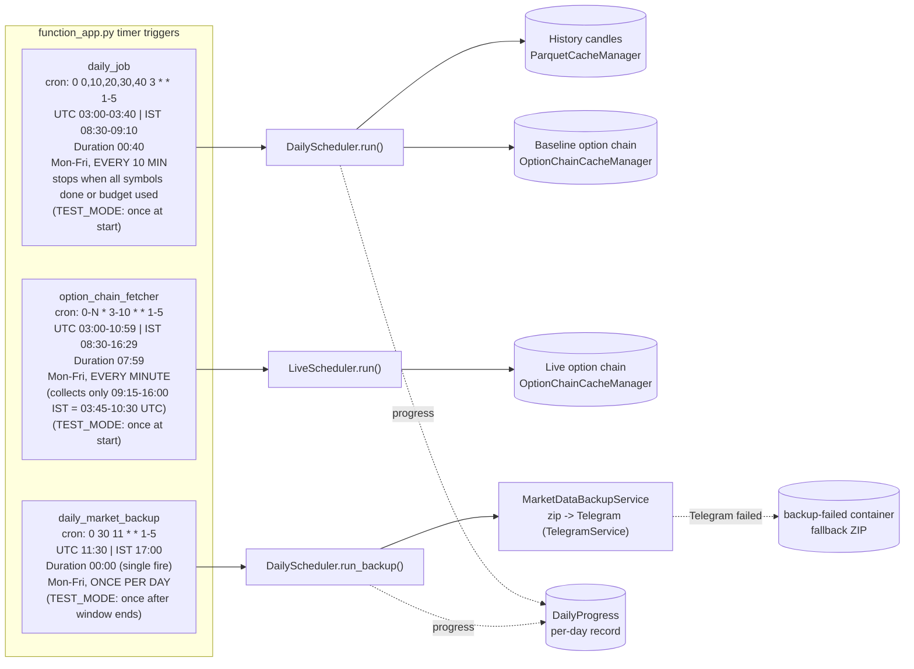
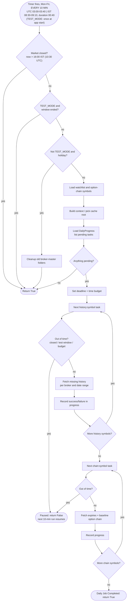
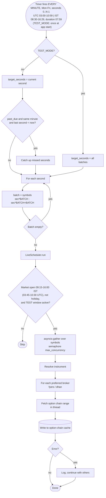
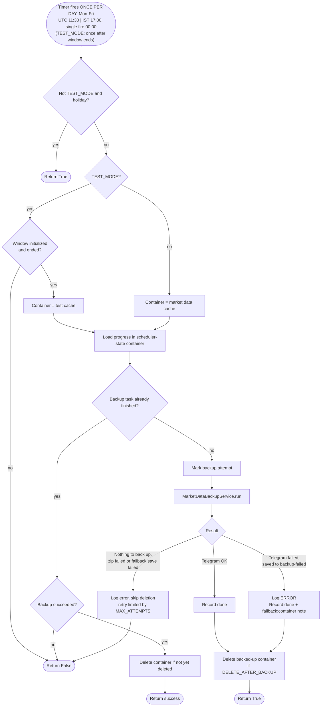
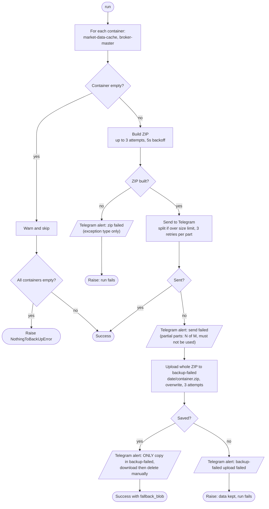

# Function App Schedulers - Flow

Timer triggers are defined in `function_app.py`. Cron times are UTC (NCRONTAB, 6 fields).
In `TEST_MODE` each job runs once at app start (`run_on_startup`). Whether the recurring cron stays depends on `RUN_ON_MARKET_HOURS` (see below).

## Schedule (UTC vs IST)

| Job | UTC | IST | Duration (hh:mm) | Frequency | When it stops |
|---|---|---|---|---|---|
| `daily_job` | 03:00-03:40 | 08:30-09:10 | 00:40 | Every 10 min (5 fires/day) | Each run stops at the 480s time budget and the next fire resumes; once all symbols are done, later fires exit immediately |
| `option_chain_fetcher` (timer window) | 03:00-10:59 | 08:30-16:29 | 07:59 | Every minute (fires at seconds 0..N-1, one symbol batch per second) | Each fire ends after its batch |
| `option_chain_fetcher` (actually collects) | 03:45-10:30 | 09:15-16:00 | 06:45 | Same as above | Skips outside market hours and holidays |
| `daily_market_backup` | 11:30 | 17:00 | 00:00 (single fire) | Once per day | Ends after backup and container delete; reruns the same day only skip already-finished steps |

All jobs run Monday to Friday. `daily_job` also stops once the market closes at 16:00 IST (10:30 UTC).

In pure test mode (`TEST_MODE=true`, `RUN_ON_MARKET_HOURS=false`) every job runs once when the app starts and does not repeat (the backup runs once, a minute after the test window ends).

## TEST_MODE and RUN_ON_MARKET_HOURS

`RUN_ON_MARKET_HOURS` defaults to `true` when the env var is missing (release branches). Set it to `false` on master/private branches for pure test behaviour.

| TEST_MODE | RUN_ON_MARKET_HOURS | Behaviour |
|---|---|---|
| false | any | Normal prod schedule. |
| true | `true` (default) | Normal Mon-Fri crons stay active and each job also runs once at app start. On a trading day (not weekend/holiday) every run behaves like prod (live container, no test window). On a weekend/holiday it behaves as test: startup run only inside the `TEST_MODE_MINUTES` window, scheduled fires skip, data goes to the test container, and a one-shot `test_mode_backup` runs after the window. |
| true | `false` | Pure test mode: every job runs once at app start, test container, no recurring schedule. |

## FORCE_BACKUP_ID (one-off live backup)

With `TEST_MODE=false`, setting `FORCE_BACKUP_ID=<value>` makes the next app start run one live backup on any day, including weekends and holidays. The ID is recorded in `scheduler-state` (`force_backup_<id>`), so later restarts with the same value do nothing. Use a new value to force another run. A failed run is retried on later restarts, up to 3 attempts.

- The container is kept unless `FORCE_BACKUP_DELETE=true` (and `DELETE_AFTER_BACKUP=true`).
- Ignored when `TEST_MODE=true`.
- Set it after 16:00 IST so the day's data is complete.

## Telegram upload parts

The backup ZIP is sent in parts of at most `TELEGRAM_PART_BYTES` (default `5MB`; accepts `512KB`, `8MB` or plain bytes, 1024-based; always capped at Telegram's 49 MB limit), with a 4 s pause between parts to stay under Telegram's group rate limit. Small parts survive dropped connections that big uploads do not. Each part's caption explains how to join the parts. If any part fails, the whole ZIP is saved to `backup-failed`.

After every successful backup a final status message is sent in the same format as the part captions (`Backup:`, `Source:`, `Trigger:`, `Date:`, `Blobs | ZIP`) ending with `Container-Deleted: true|false`. It is `false` when the container is kept (for example a forced run without `FORCE_BACKUP_DELETE=true`, `DELETE_AFTER_BACKUP=false`, or a failed deletion). If Telegram failed, the message also says the ZIP is only in `backup-failed`.

## Overview

## daily_job -> DailyScheduler.run()

## option_chain_fetcher -> LiveScheduler.run()

## daily_market_backup -> DailyScheduler.run_backup()

### MarketDataBackupService.run()

Notes:
- Alerts are best effort; if Telegram is fully down the alert cannot be delivered either, so check the ERROR log.
- `backup-failed` is never pruned automatically.
- Source containers are deleted only after success or a saved fallback.
